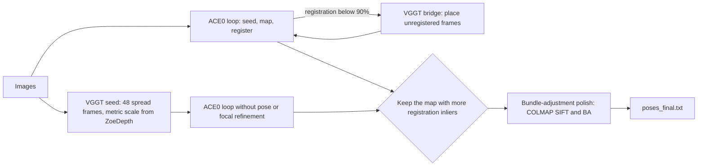

# Scene Coordinate Reconstruction from Unposed Images: PGO and Beyond

This repository accompanies the paper

> **Learning Scene Coordinate Reconstruction from Unposed Images via Pose Graph Optimization**<br>
> Tze Ho Elden Tse, Jizong Peng, Angela Yao<br>
> dConstruct Robotics, National University of Singapore<br>
> **CVPR 2026 (Highlight)** · [Conference page](https://cvpr.thecvf.com/virtual/2026/poster/40234)

This repository is a modified version of [ACE-Zero](https://github.com/nianticlabs/acezero) and is distributed under the ACE0 license, for non-commercial use only (see [License](#license)). **Copyright © Niantic, Inc. 2024. All rights reserved.**

It builds on [ACE-Zero](https://nianticlabs.github.io/acezero/) (ACE0), which reconstructs camera poses from unordered images by incrementally training a scene coordinate regressor. The repository contains:

1. **The paper's method.** Pose graph optimization (PGO) inside the ACE0 loop: pose graphs built from predicted scene coordinates, with edges weighted by epipolar and optical-flow confidence. The paper's results were produced with an internal pose graph optimizer that we cannot release, so this repository provides a re-implementation based on [GTSAM](https://gtsam.org) (see [The paper's method](#the-papers-method-pose-graph-optimization)).
2. **An extension.** Re-evaluating the method under one evaluation pipeline for every method, we developed further stages: VGGT-based bridging of unregistered frames, focal-length handling, a VGGT-seeded reconstruction for scenes where ACE0's own map stalls or warps, and a final bundle-adjustment polish. Four configurations of increasing scope (v1 to v4) each have their own reproduction script.

These configurations do not include the GTSAM pose graph stage, so the results reported for v1 to v4 come from the extension stages.

**Contents**

- [Results](#results)
- [The extension: v1 to v4](#the-extension-v1-to-v4)
- [Installation](#installation)
- [Data preparation](#data-preparation)
- [Reproducing the results](#reproducing-the-results)
- [The paper's method: pose graph optimization](#the-papers-method-pose-graph-optimization)
- [Running on your own images](#running-on-your-own-images)
- [Repository layout](#repository-layout)
- [Limitations and caveats](#limitations-and-caveats)
- [Acknowledgements and license](#acknowledgements-and-license)

---

## Results

Pose quality is measured by novel view synthesis, as in ACE0 and the paper: each method's poses train a Nerfacto model, and PSNR (dB) is computed on held-out images. **All columns except "Paper" come from the same evaluation pipeline**, including vanilla ACE0 and the COLMAP reference poses.

Our pipeline scores every method lower than the paper's does, COLMAP included (by 0.1 to 1.9 dB per dataset). So compare **gains over ACE0** and **distance to COLMAP**, not absolute PSNR across the two.

### Summary

Average PSNR per dataset.

| Dataset | ACE0 | v1 | v2 | v3 | **v4** | COLMAP | Paper ACE0 | Paper Ours | Paper COLMAP |
|---|---:|---:|---:|---:|---:|---:|---:|---:|---:|
| 7-Scenes | 20.66 | 20.84 | 20.84 | 20.84 | **21.23** | 21.13 | 21.16 | 21.79 | 21.23 |
| Mip-NeRF 360 | 21.36 | 22.53 | 22.53 | 22.53 | **23.44** | 23.37 | 22.91 | 24.33 | 24.73 |
| Tanks and Temples: Training | 16.62 | 17.02 | 17.02 | 16.98 | **18.32** | 18.01 | 17.78 | 18.40 | 19.87 |
| Tanks and Temples: Intermediate | 16.74 | 17.15 | 17.15 | 17.62 | **17.06** | 17.25 | 18.28 | 18.78 | 18.80 |
| Tanks and Temples: Advanced | 13.57 | 13.73 | 15.10 | 15.23 | **15.40** | 15.96 | 14.54 | 16.82 | 17.28 |
| Tanks and Temples: all 17 scenes | 15.76 | 16.10 | 16.50 | 16.69 | **17.02** | 17.14 | 17.01 | 18.07 | 18.73 |

Gain over ACE0, and distance to COLMAP (positive means above COLMAP).

| Dataset | v1 | v2 | v3 | **v4** | Paper | v4 vs COLMAP | Paper vs COLMAP |
|---|---:|---:|---:|---:|---:|---:|---:|
| 7-Scenes | +0.18 | +0.18 | +0.18 | **+0.58** | +0.63 | +0.10 | +0.56 |
| Mip-NeRF 360 | +1.17 | +1.17 | +1.17 | **+2.08** | +1.41 | +0.07 | -0.40 |
| Tanks and Temples: Training | +0.40 | +0.40 | +0.36 | **+1.70** | +0.62 | +0.32 | -1.47 |
| Tanks and Temples: Intermediate | +0.41 | +0.41 | +0.89 | **+0.32** | +0.50 | -0.20 | -0.02 |
| Tanks and Temples: Advanced | +0.16 | +1.53 | +1.67 | **+1.83** | +2.28 | -0.57 | -0.46 |
| Tanks and Temples: all 17 scenes | +0.33 | +0.74 | +0.93 | **+1.25** | +1.06 | -0.12 | -0.66 |

v4 is within 0.05 dB of the paper's gain on 7-Scenes, exceeds it on Mip-NeRF 360, Tanks and Temples Training and Tanks and Temples overall, and is within 0.5 dB on the Intermediate and Advanced splits.

### Per-scene results

The "Paper" columns are copied from the paper (Tables 1 to 3, Tanks and Temples short version). On 7-Scenes and Mip-NeRF 360, v1 to v3 share the same configuration.

<details open>
<summary><b>7-Scenes</b></summary>

| Scene | ACE0 | v1-v3 | v4 | COLMAP | Paper ACE0 | Paper Ours | Paper COLMAP |
|---|---:|---:|---:|---:|---:|---:|---:|
| chess | 22.88 | 22.77 | **23.44** | 22.89 | 23.3 | 23.5 | 23.6 |
| fire | 22.09 | 22.07 | **22.40** | 22.27 | 22.3 | 22.6 | 22.6 |
| heads | 18.13 | 18.41 | **18.17** | 17.99 | 18.8 | 19.2 | 18.8 |
| office | 21.35 | 21.07 | **20.97** | 20.88 | 21.1 | 21.6 | 21.4 |
| pumpkin | 22.27 | 23.69 | **23.44** | 22.07 | 24.1 | 24.3 | 24.1 |
| redkitchen | 20.49 | 20.68 | **20.12** | 20.86 | 20.8 | 21.2 | 21.4 |
| stairs | 17.40 | 17.16 | **20.10** | 20.96 | 17.7 | 20.1 | 16.7 |
| **Average** | 20.66 | 20.84 | **21.23** | 21.13 | 21.16 | 21.79 | 21.23 |

</details>

<details open>
<summary><b>Mip-NeRF 360</b></summary>

| Scene | ACE0 | v1-v3 | v4 | COLMAP | Paper ACE0 | Paper Ours | Paper COLMAP |
|---|---:|---:|---:|---:|---:|---:|---:|
| bicycle | 18.22 | 18.66 | **20.42** | 20.44 | 18.7 | 21.9 | 21.5 |
| bonsai | 24.94 | 25.10 | **26.36** | 26.60 | 25.8 | 26.6 | 27.6 |
| counter | 23.71 | 23.87 | **24.74** | 24.90 | 24.5 | 25.2 | 25.5 |
| garden | 19.60 | 19.65 | **19.97** | 19.19 | 25.0 | 26.6 | 26.3 |
| kitchen | 24.07 | 24.33 | **24.34** | 25.39 | 26.1 | 26.8 | 27.4 |
| room | 19.05 | 25.41 | **26.10** | 25.87 | 19.8 | 21.8 | 28.0 |
| stump | 19.91 | 20.68 | **22.12** | 21.21 | 20.5 | 21.4 | 16.8 |
| **Average** | 21.36 | 22.53 | **23.44** | 23.37 | 22.91 | 24.33 | 24.73 |

</details>

<details open>
<summary><b>Tanks and Temples: Training</b></summary>

| Scene | ACE0 | v1 | v2 | v3 | v4 | COLMAP | Paper ACE0 | Paper Ours | Paper COLMAP |
|---|---:|---:|---:|---:|---:|---:|---:|---:|---:|
| Barn | 16.62 | 20.31 | 20.31 | 20.15 | **23.08** | 21.62 | 16.4 | 18.5 | 24.0 |
| Caterpillar | 16.50 | 15.92 | 15.92 | 16.15 | **16.05** | 16.51 | 16.9 | 17.0 | 17.1 |
| Church | 14.76 | 15.02 | 15.02 | 15.33 | **15.64** | 16.95 | 17.1 | 17.1 | 18.3 |
| Ignatius | 17.10 | 18.41 | 18.41 | 15.73 | **17.13** | 17.37 | 19.6 | 19.6 | 20.1 |
| Meetingroom | 16.80 | 14.37 | 14.37 | 16.38 | **19.03** | 17.03 | 16.6 | 17.2 | 18.6 |
| Truck | 17.95 | 18.10 | 18.10 | 18.13 | **19.02** | 18.56 | 20.1 | 21.0 | 21.1 |
| **Average** | 16.62 | 17.02 | 17.02 | 16.98 | **18.32** | 18.01 | 17.78 | 18.40 | 19.87 |

</details>

<details open>
<summary><b>Tanks and Temples: Intermediate</b></summary>

| Scene | ACE0 | v1 | v2 | v3 | v4 | COLMAP | Paper ACE0 | Paper Ours | Paper COLMAP |
|---|---:|---:|---:|---:|---:|---:|---:|---:|---:|
| Family | 14.06 | 15.16 | 15.16 | 16.68 | **13.25** | 13.27 | 18.9 | 19.1 | 19.5 |
| Francis | 19.46 | 20.08 | 20.08 | 19.73 | **19.97** | 20.51 | 20.0 | 21.0 | 21.6 |
| Horse | 18.68 | 17.34 | 17.34 | 17.88 | **17.23** | 18.12 | 19.3 | 19.2 | 19.2 |
| Lighthouse | 16.53 | 16.62 | 16.62 | 16.63 | **16.90** | 17.15 | 17.0 | 17.8 | 16.6 |
| Playground | 16.08 | 18.32 | 18.32 | 19.19 | **19.60** | 18.94 | 18.5 | 19.0 | 19.1 |
| Train | 15.61 | 15.36 | 15.36 | 15.63 | **15.39** | 15.54 | 16.0 | 16.6 | 16.8 |
| **Average** | 16.74 | 17.15 | 17.15 | 17.62 | **17.06** | 17.25 | 18.28 | 18.78 | 18.80 |

</details>

<details open>
<summary><b>Tanks and Temples: Advanced</b></summary>

| Scene | ACE0 | v1 | v2 | v3 | v4 | COLMAP | Paper ACE0 | Paper Ours | Paper COLMAP |
|---|---:|---:|---:|---:|---:|---:|---:|---:|---:|
| Auditorium | 15.64 | 15.22 | 15.22 | 15.86 | **15.77** | 15.49 | 18.0 | 19.1 | 19.6 |
| Ballroom | 16.27 | 16.64 | 16.64 | 16.31 | **17.03** | 15.55 | 17.9 | 18.3 | 16.3 |
| Courtroom | 15.23 | 15.14 | 15.14 | 15.28 | **15.80** | 16.16 | 16.9 | 17.4 | 18.2 |
| Palace | 10.94 | 12.47 | 12.41 | 12.72 | **11.78** | 14.72 | 10.0 | 13.6 | 14.2 |
| Temple | 9.75 | 9.18 | 16.09 | 16.00 | **16.60** | 17.89 | 9.9 | 15.7 | 18.1 |
| **Average** | 13.57 | 13.73 | 15.10 | 15.23 | **15.40** | 15.96 | 14.54 | 16.82 | 17.28 |

</details>

### Evaluation protocol

- **Renderer:** Nerfacto (nerfstudio 1.1.3), images downscaled to at most 640 px, NeRF camera optimizer off.
- **Held-out images:** 7-Scenes uses the official test sequences, Mip-NeRF 360 and Tanks and Temples use every 8th image. Images with pose confidence below 1000 are excluded from NeRF training.
- **Reference poses:**
  - 7-Scenes: the published COLMAP pseudo ground truth of [Brachmann et al. (ICCV 2021)](https://github.com/tsattler/visloc_pseudo_gt_limitations).
  - Mip-NeRF 360: the dataset's own COLMAP models.
  - Tanks and Temples: the ACE0 authors' published COLMAP reconstructions.
- **Noise:** a single Nerfacto evaluation can vary by up to about 3 dB on some Tanks and Temples scenes. Repeated evaluations of identical poses gave 15.5 to 18.4 dB on Ignatius and 12.9 to 16.7 dB on Family, so dataset averages are more reliable than single scenes. Family and Horse in the v4 column are medians of three evaluations.

---

## The extension: v1 to v4

Each version adds to the previous one. All new behaviour sits behind `ace_zero.py` flags that default to off, so all four versions run on the same code, each with its own flags and reproduction script.

| Version | Script | Adds | Key flags |
|---|---|---|---|
| v1 | `scripts/reproduce_ours_v1.sh` | VGGT bridging of unregistered frames; self-supervised focal freeze on 7-Scenes and Tanks and Temples (per-scene focal handling on Mip-NeRF 360) | `--enable_bridge True --bridge_mode vggt --calibration_freeze_rate 0.45` |
| v2 | `scripts/reproduce_ours_v2.sh` | Rescue of stalled scenes: a run that ends with under 80% of images registered is redone from a VGGT seed | `--vggt_rescue_below_rate 0.8` |
| v3 | `scripts/reproduce_ours_v3.sh` | No focal freeze on Tanks and Temples (same code as v2, only flags change) | (freeze flag removed for Tanks and Temples) |
| v4 | `scripts/reproduce_ours_v4.sh` | VGGT-seed selection for every scene, plus bundle-adjustment polish | `--vggt_seed_select True --ba_polish True` |



What each stage does, and why:

- **VGGT bridging** (`vggt_bridge.py`, v1+). ACE0 grows a reconstruction by relocalizing new images against the current map, and stalls when an image collection has visually disjoint parts. While registration is below 90%, unregistered frames are posed jointly with registered "anchor" frames in one [VGGT](https://github.com/facebookresearch/vggt) pass, then aligned to the map with a Sim(3). A chunk is rejected if its anchors align with a median residual above 5% of their spread. Alignments that pass but are borderline proved harmful, which is why the threshold is 5%.
- **Focal handling** (v1+). Joint refinement can push the focal length away from the truth. v1 freezes it once registration reaches 45% and the focal changes by less than 3% per iteration. On Tanks and Temples that rule fires while the focal is still falling from its high initial guess, so v3 drops it there: final focal error over 15 scenes went from 5.7% to 3.7%.
- **VGGT seed** (`vggt_seed.py`, `--seed_from_vggt N`). Instead of a single-image depth seed, one VGGT pass over N frames spread across the collection is scaled to metric with ZoeDepth and becomes the first registered set. ACE's pose refiner degrades such an accurate seed (Temple: 5 cm median error grows to 37 cm), so seeded runs switch off pose and focal refinement.
  - **v2** uses the seed only to rescue stalled scenes. Temple's registration rises from 8% to 93% and its PSNR from 9.2 to 16.1 dB.
  - **v4** (`--vggt_seed_select`) runs the seeded reconstruction for every scene and keeps whichever map registers the images with more inliers on average. The seed wins where ACE0's own map is warped (7-Scenes Stairs: 17.2 to 20.1 dB); ACE0 wins where VGGT is confidently wrong (symmetric rooms such as Courtroom and Ballroom). On the 6 switched scenes where both variants were evaluated, the rule picked the better one 5 times.
- **Bundle-adjustment polish** (`ba_polish.py`, `--ba_polish`, v4). ACE0's poses are accurate to about 1% of the scene radius, which on textured scenes is still several pixels of reprojection error. Starting from ACE0's poses, the polish matches SIFT features between nearby views, triangulates with poses held fixed, then bundle-adjusts the poses and the shared focal length (COLMAP command-line tool). COLMAP picks its own coordinate frame during bundle adjustment, so refined poses are mapped back onto the input frame. On Bicycle, error relative to COLMAP drops from 0.65% to 0.11% of the scene radius and from 0.23° to 0.06°, and PSNR rises from 18.7 to 20.4 dB. Full bundle adjustment goes beyond the paper, which lists it as future work.

---

## Installation

Tested on Ubuntu 22.04 with one RTX 3090 (24 GB). The VGGT stages need about 10 to 12 GB of GPU memory for a 48-frame pass.

Three conda environments keep conflicting dependencies apart; the scripts switch between them with `conda run`.

| Environment | Used for | Python / PyTorch / CUDA |
|---|---|---|
| `ace0` | ACE0 reconstruction, PGO, bridging, polish driver | 3.8 / 2.0.0 / 11.8 |
| `vggt` | VGGT inference (bridge, seed, focal estimate) | 3.11 / 2.3.1 / 12.1 |
| `nerfstudio` | Nerfacto view-synthesis evaluation | 3.10 / 2.11.0 / 13.0 |

**1. ACE0 environment**

```shell
conda env create -f environment.yml -n ace0
conda activate ace0
pip install gtsam==4.2            # required: the VGGT bridge reuses helpers from pgo_gtsam.py

# DSAC* RANSAC bindings (C++)
cd dsacstar && python setup.py install && cd ..

# pretrained ACE encoder (distributed with ACE-Zero, not included here)
wget https://github.com/nianticlabs/acezero/raw/main/ace_encoder_pretrained.pt
```

The first ACE0 run downloads ZoeDepth through `torch.hub` and may ask you to trust the repository; run one reconstruction interactively before launching batch scripts.

**2. VGGT environment**

```shell
git clone https://github.com/facebookresearch/vggt.git vggt     # must live at ./vggt
conda create -n vggt python=3.11 -y
conda activate vggt
pip install torch==2.3.1 torchvision==0.18.1 --index-url https://download.pytorch.org/whl/cu121
pip install -r vggt/requirements.txt
```

The VGGT-1B weights (about 5 GB, `facebook/VGGT-1B`) are downloaded to the `torch.hub` cache on first use.

**3. Nerfstudio environment** (evaluation only)

```shell
conda create -n nerfstudio python=3.10 -y
conda activate nerfstudio
pip install torch torchvision      # a CUDA build matching your driver
pip install nerfstudio==1.1.3
```

See the [nerfstudio installation guide](https://docs.nerf.studio/quickstart/installation.html) for optional extras such as tiny-cuda-nn.

**4. COLMAP** (v4 only)

`--ba_polish` calls the `colmap` command-line tool (tested with COLMAP 3.14, built with CUDA). Install it from your package manager or [build it from source](https://colmap.github.io/install.html), and make sure `colmap` is on your `PATH`.

**Note:** all scripts set `PYTHONNOUSERSITE=1`. Packages in `~/.local` otherwise shadow the conda environments, which silently changes library versions.

---

## Data preparation

Commands run from the repository root unless noted. Each setup script asks you to accept the dataset's license.

**7-Scenes**

```shell
cd datasets && python setup_7scenes.py --poses pgt && cd ..   # images -> datasets/7scenes, clones the pseudo-GT repo
python scripts/create_splits_7scenes.py datasets/7scenes split_files
python scripts/make_7scenes_colmap_refs.py                     # COLMAP reference poses for the COLMAP column
```

**Mip-NeRF 360**

```shell
cd datasets && python setup_mip360.py && cd ..                 # -> datasets/mip360/<scene>/images_4
python scripts/create_splits_mip360.py datasets/mip360 split_files
```

**Tanks and Temples** (short "image set" version)

```shell
# put the image-set archives training.zip, intermediate.zip and advanced.zip into datasets/t2/
# (from https://www.tanksandtemples.org/download/, or: python datasets/download_t2_dataset.py --modality image --group all --pathname datasets/t2)
cd datasets && python setup_t2.py && cd ..                     # unpacks to datasets/t2/<split>/<Scene>/*.jpg; missing archives are skipped

# COLMAP reference reconstructions published by the ACE0 authors
wget https://storage.googleapis.com/niantic-lon-static/research/acezero/colmap_raw.tar.gz
mkdir -p datasets/t2_colmap_raw && tar -xzf colmap_raw.tar.gz -C datasets/t2_colmap_raw
```

Tanks and Temples needs no split files: every 8th image is held out.

Expected layout:

```
datasets/7scenes/<scene>/seq-XX/frame-XXXXXX.color.png
datasets/mip360/<scene>/images_4/*.JPG
datasets/t2/<split>/<Scene>/*.jpg
datasets/t2_colmap_raw/<split>__<Scene>/0/{cameras,images,points3D}.bin
split_files/{7scenes,mip360}_<scene>.json
```

---

## Reproducing the results

### Our configurations (v1 to v4)

Each `scripts/reproduce_ours_vN.sh` reproduces one configuration on all 31 scenes:

```shell
bash scripts/reproduce_ours_v4.sh                                      # everything
DATASETS="mip360" bash scripts/reproduce_ours_v4.sh                    # one dataset
ONLY="7scenes/stairs t2/advanced/Temple" bash scripts/reproduce_ours_v4.sh
DRY_RUN=1 bash scripts/reproduce_ours_v4.sh                            # print the commands only
SUMMARY_ONLY=1 bash scripts/reproduce_ours_v4.sh                       # table: result vs reference vs ACE0
```

Run ids look like `mip360/bicycle`, `7scenes/stairs` and `t2/advanced/Temple`.

How the scripts work:

- **Inputs.** Scripts run from the repository root and read `datasets/`, `split_files/` and `vggt/` (see [Installation](#installation) and [Data preparation](#data-preparation)). Each run records the commit it used in `ours_vN_config.txt`.
- **Outputs** go to `reconstructions/ours_vN/<run>/` and `benchmark/ours_vN/<run>/`. The PSNR is in `.../nerf_data/nerf_for_eval/nerfacto/run/eval.json`.
- **Resumable.** Finished runs are skipped, interrupted ones are moved aside, and a lock prevents two copies running at once. Package versions of the three environments (and the COLMAP version, for v4) are saved under `reconstructions/ours_vN/env/`.
- **Runtime** on one RTX 3090 is about 1 to 2 hours per scene including Nerfacto, or about 2 days for all 31 scenes. v4 adds a seeded reconstruction and the polish, roughly 15 to 60 minutes per scene. Run long jobs inside `tmux` or `screen`.
- **Variation between runs.** ACE0 training is not bit-deterministic, and Nerfacto evaluation adds further noise (see [Evaluation protocol](#evaluation-protocol)). Expect differences of a few tenths of a dB per scene, and occasionally more on Tanks and Temples.

### Baselines (ACE0 and COLMAP columns)

```shell
CONFIGS="ace0 colmap" bash scripts/reproduce_mip360.sh
CONFIGS="ace0 colmap" bash scripts/reproduce_7scenes.sh        # needs scripts/make_7scenes_colmap_refs.py first
CONFIGS="ace0 colmap" bash scripts/reproduce_t2.sh             # RAW_COLMAP=... if not datasets/t2_colmap_raw
```

These run vanilla ACE0 (all extension flags off) and evaluate the COLMAP reference poses with the same pipeline. Their `ours` configuration predates v1 to v4; use `reproduce_ours_vN.sh` for our results.

### Experiments

`scripts/exp_run.sh` runs any scene with the v3 flags plus your overrides, from the current working tree:

```shell
TAG=my_test RUNS="7scenes/stairs" EXTRA="--vggt_seed_select True --ba_polish True" BENCH=1 bash scripts/exp_run.sh
```

New ideas should become a new version: copy the latest `reproduce_ours_vN.sh` and add flags, keeping new features off by default so existing versions keep their behaviour. Never edit the flags of an existing version.

---

## The paper's method: pose graph optimization

The results in the paper were produced with an internal pose graph optimizer that we cannot release. This repository provides a re-implementation of the paper's PGO stage on top of GTSAM, in `pgo_gtsam.py`. `ace_zero.py` calls it after each mapping and registration iteration:

- **Graph construction.** Pixels whose predicted scene coordinates agree across two images within a threshold τ form correspondences. τ decays from 0.2 m to 0.05 m over the iterations. Relative poses come from PnP with RANSAC.
- **Confidence.** Epipolar distance and RAFT optical-flow consistency, combined into each edge's information matrix.
- **Optimization.** GTSAM with Levenberg–Marquardt and a Huber loss, a tight prior on the first pose, and loose priors on nodes left unconnected.

```shell
python ace_zero.py "/path/to/images/*.jpg" result_folder \
    --enable_pgo_gtsam True --enable_pgo_conf_est True \
    --pgo_tau_start 0.2 --pgo_tau_end 0.05 --pgo_tau_decay_iterations 10
```

`--enable_solver True` selects an alternative SE(3) solver (`solver.py`). Because the released GTSAM version is not the optimizer used for the paper's results, the v1 to v4 configurations run with it switched off.

---

## Running on your own images

```shell
# plain ACE0
python ace_zero.py "/path/to/images/*.jpg" result_folder

# our most complete configuration (needs the vggt environment and COLMAP)
python ace_zero.py "/path/to/images/*.jpg" result_folder \
    --enable_bridge True --bridge_mode vggt \
    --vggt_rescue_below_rate 0.8 --vggt_seed_select True --ba_polish True
```

Quote the glob so the shell does not expand it. The result is `result_folder/poses_final.txt`, with one line per image:

```
filename qw qx qy qz x y z focal_length confidence
```

- **Pose convention:** world-to-camera, OpenCV convention. All images share one focal length, and the principal point is assumed to be the image centre.
- **Confidence** is the number of registration inliers. Treat images below 1000 as unregistered.
- **Seeded runs** leave their result in `result_folder/vggt_rescue/`. `poses_final_stalled.txt` and `poses_final_prepolish.txt` keep the intermediate poses.

Other useful ACE0 options:

| Option | Effect |
|---|---|
| `--use_external_focal_length F` | initialize the focal length (add `--refine_calibration False` to keep it fixed) |
| `--focal_from_vggt True` | use VGGT's focal estimate as the initial value |
| `--render_visualization True` | render a reconstruction video (slow; not supported together with VGGT seeding) |
| `--export_point_cloud True` | write `pc_final.ply` |

Utility scripts:

| Script | Purpose |
|---|---|
| `export_point_cloud.py` | point cloud from a network and a pose file |
| `export_cameras.py` | camera frusta as a PLY mesh |
| `eval_poses.py` | pose error against ground truth, after a similarity alignment |
| `datasets/video_to_dataset.py` | extract frames from MP4 videos |
| `python -m benchmarks.benchmark_poses` | run the Nerfacto evaluation on any pose file (in the `nerfstudio` environment) |

For the full ACE0 feature set (refining existing poses, starting from partial reconstructions, relocalization), see the [ACE0 repository](https://github.com/nianticlabs/acezero).

---

## Repository layout

| Path | Contents |
|---|---|
| `ace_zero.py` | main reconstruction loop with all extension flags |
| `train_ace.py`, `register_mapping.py`, `ace_*.py` | ACE mapping and registration (ACE0) |
| `pgo_gtsam.py`, `solver.py` | the paper's pose graph optimization (GTSAM re-implementation) |
| `vggt_bridge.py`, `vggt_infer.py` | VGGT bridging of unregistered frames |
| `vggt_seed.py`, `vggt_focal.py` | VGGT seed and VGGT focal estimate |
| `ba_polish.py` | bundle-adjustment polish (COLMAP CLI) |
| `bridge_registration.py` | earlier optical-flow bridge (`--bridge_mode flow`) |
| `benchmarks/` | Nerfacto view-synthesis evaluation |
| `scripts/reproduce_ours_v{1,2,3,4}.sh` | reproductions of our configurations v1 to v4 |
| `scripts/reproduce_{7scenes,mip360,t2}.sh` | ACE0 and COLMAP baselines |
| `scripts/exp_run.sh`, `scripts/exp_t2adv.sh` | experiment runners |
| `scripts/create_splits_*.py`, `scripts/make_7scenes_colmap_refs.py` | split files and reference poses |
| `datasets/` | dataset download and setup scripts |
| `scripts/vggt_*.sh` | VGGT-SLAM baseline runs and their Nerfacto evaluation (needs a VGGT-SLAM clone in `VGGT-SLAM-public/`) |

---

## Limitations and caveats

- **Different evaluation.** Absolute PSNR is not comparable with the paper's tables; our pipeline scores all methods lower. Compare gains and distances to COLMAP.
- **Single-run noise.** Single-scene numbers can vary by up to about 3 dB on some Tanks and Temples scenes. Dataset averages are the meaningful comparison.
- **How the v4 references were produced.** They come from applying the selection rule to existing v3 runs and seeded runs, then polishing; they are not from one fresh end-to-end run of all 31 scenes. The integrated flags were validated end to end on Bicycle (20.50 dB) and Train (15.77 dB).
- **Known weak spots in v4.**
  - Palace regresses under the polish (11.78 vs 12.72 dB in v3); a third of its images stay unregistered, so they are not refined.
  - Garden scores about 19 to 20 dB for every method, COLMAP included, in our evaluation, against about 25 to 26 dB in the paper. The cause is unexplained; ACE0's Garden poses match COLMAP's to 0.8% of the scene radius.
- **Hyperparameters tuned on the benchmark.** Some choices (per-dataset focal handling, the rescue threshold) were made on these benchmark scenes.
- **Beyond the paper.** v4 uses VGGT and COLMAP bundle adjustment, which the paper does not.
- **Not reproduced.** The Tanks and Temples long (video) version, the paper's runtime claims, and the SLAM baselines.

---

## Acknowledgements and license

This work builds on [ACE-Zero](https://github.com/nianticlabs/acezero) and [ACE](https://github.com/nianticlabs/ace) by Niantic. It also uses [VGGT](https://github.com/facebookresearch/vggt), [ZoeDepth](https://github.com/isl-org/ZoeDepth), [GTSAM](https://gtsam.org), [COLMAP](https://colmap.github.io), [nerfstudio](https://nerf.studio) and the DSAC* RANSAC implementation.

### License

**Copyright © Niantic, Inc. 2024. All rights reserved.**

This repository is a modified version of ACE-Zero and is distributed as a whole under the ACE0 license in [`LICENSE`](LICENSE), reproduced unmodified: non-commercial use only. The DSAC* code in `dsacstar/` carries its own BSD license, included in the same file. Datasets and third-party models (VGGT, ZoeDepth) have their own licenses; the setup scripts link to the dataset licenses.

Changes relative to ACE-Zero:

- **Modified files:** `ace_zero.py`, `ace_visualizer.py`, `register_mapping.py`, `benchmarks/preprocess_data.py`, `benchmarks/run_benchmark.py`, `benchmarks/run_nerfstudio.py`, `environment.yml`, `README.md`, `.gitignore`.
- **Added files:** `ba_polish.py`, `bridge_registration.py`, `pgo_gtsam.py`, `solver.py`, `vggt_bridge.py`, `vggt_focal.py`, `vggt_infer.py`, `vggt_seed.py`, `datasets/download_t2_dataset.py` (the official Tanks and Temples downloader, by its authors), `scripts/make_7scenes_colmap_refs.py`, and the shell scripts `scripts/reproduce_ours_v{1,2,3,4}.sh`, `scripts/reproduce_{7scenes,mip360,t2}.sh`, `scripts/exp_run.sh`, `scripts/exp_t2adv.sh` and `scripts/vggt_*.sh`.
- **Not included:** the pretrained ACE encoder `ace_encoder_pretrained.pt`; download it from ACE-Zero (see [Installation](#installation)).

### Citation

If you use this code, please cite our paper and ACE-Zero:

```bibtex
@inproceedings{tse2026pgo,
  title     = {Learning Scene Coordinate Reconstruction from Unposed Images via Pose Graph Optimization},
  author    = {Tse, Tze Ho Elden and Peng, Jizong and Yao, Angela},
  booktitle = {Proceedings of the IEEE/CVF Conference on Computer Vision and Pattern Recognition (CVPR)},
  year      = {2026}
}

@inproceedings{brachmann2024acezero,
  title     = {Scene Coordinate Reconstruction: Posing of Image Collections via Incremental Learning of a Relocalizer},
  author    = {Brachmann, Eric and Wynn, Jamie and Chen, Shuai and Cavallari, Tommaso and Monszpart, {\'A}ron and Turmukhambetov, Daniyar and Prisacariu, Victor Adrian},
  booktitle = {ECCV},
  year      = {2024}
}
```
